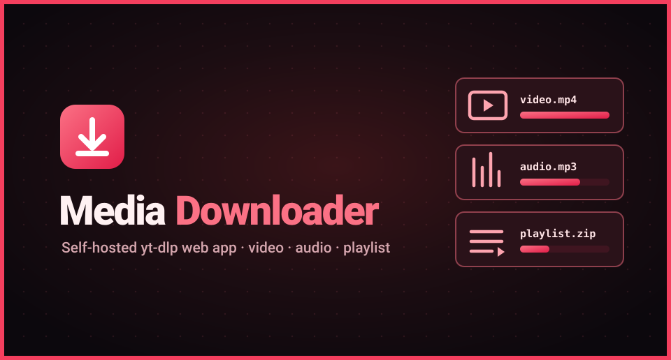

# Media Downloader



A small self-hosted web app around [yt-dlp](https://github.com/yt-dlp/yt-dlp) and [FFmpeg](https://ffmpeg.org/) to download video, audio and playlists from YouTube and the other sites yt-dlp supports. It runs in one Docker container on my Synology NAS.

**Live demo:** https://yt-downloader.akmal-satrio-n.my.id

## Features

- Paste a link, check it, then pick **video** (quality, container MP4/MKV/WebM/MOV, codec, frame rate) or **audio** (MP3, M4A, Opus, FLAC, WAV and more, bitrate, sample rate).
- Full format list from the source, to pick an exact format by hand.
- Playlists: download all or only some items (`1-10,15`), zipped into one file.
- Cut a part of the video (`1:30` to `3:45`), subtitles (embedded or `.srt`), SponsorBlock segment removal, chapters, cover art and music tags.
- Download queue with live progress, speed and ETA, cancel and logs. Finished files are removed automatically after a few hours.
- Light and dark theme, works on phones.
- No framework and no database: one Python standard-library server (`app/server.py`) and one HTML page (`app/static/index.html`). yt-dlp is updated every time the container starts.

## Public mode

The same container serves the private LAN version and the public site. Requests that arrive through the public reverse proxy carry the header `X-Ytdl-Public: 1`, and for those the app:

- keeps every visitor's queue separate (random `ytdl_owner` cookie), so nobody sees or deletes someone else's downloads;
- does not use the owner's `cookies.txt`;
- refuses private, loopback and LAN addresses and turns off yt-dlp's generic extractor, so it cannot be used to reach internal services;
- applies limits: 2 downloads at a time per visitor, videos up to 3 hours, files up to 2 GB, playlists up to 20 items, files deleted after 3 hours;
- hides the "Update yt-dlp" button (`/api/update` only works from the LAN).

The proxy also rate-limits per IP. See [`deploy/nginx-public.conf`](deploy/nginx-public.conf). Never expose port 18096 to the internet without that proxy, because direct requests get the full LAN mode.

## Run

```sh
docker compose up -d --build
```

Then open `http://<host>:18096`. Settings are environment variables in `compose.yml`:

| Variable | Default | Meaning |
|---|---|---|
| `PORT` | `18096` | HTTP port |
| `KEEP_HOURS` | `24` | How long LAN downloads are kept |
| `MAX_PARALLEL` | `2` | Downloads running at the same time |
| `PUBLIC_KEEP_HOURS` | `3` | How long public visitors' files are kept |
| `PUBLIC_MAX_ACTIVE` | `2` | Queued + running jobs per public visitor |
| `PUBLIC_MAX_SECONDS` | `10800` | Longest video allowed in public mode |
| `PUBLIC_MAX_FILESIZE` | `2G` | Largest file allowed in public mode |
| `PUBLIC_MAX_ITEMS` | `20` | Playlist items per public job |

If YouTube asks to "sign in to confirm you're not a bot" on the LAN version, put a Netscape-format `cookies.txt` exported from your browser at `data/cookies.txt` (only the LAN mode uses it).

## Note

Only download content you have the right to download, and follow the terms of the sites you use.
